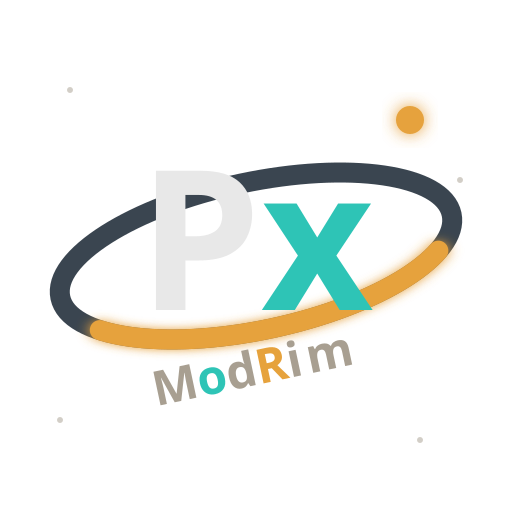
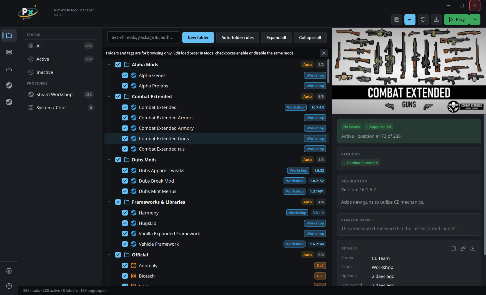

<p align="center">
  
</p>

<p align="center">
  A RimWorld mod manager with load-order sorting, conflict checks, and built-in Steam Workshop downloading.
</p>

<p align="center">
  
  
  
  
</p>



## Downloads

Pick the build that fits how you play. **NativeWorkshop** is the recommended version for most people.

| Build | What's included | Windows | Linux | macOS |
|---|---|---|---|---|
| **NativeWorkshop** | Mod sorter + native Workshop browser and downloader | [Installer](https://github.com/PyXiion/PxModRim/releases/latest/download/PxModRim-Windows-NativeWorkshop-Setup.exe) | [AppImage](https://github.com/PyXiion/PxModRim/releases/latest/download/PxModRim-Linux-x86_64-NativeWorkshop.AppImage) | [DMG](https://github.com/PyXiion/PxModRim/releases/latest/download/PxModRim-macOS-NativeWorkshop.dmg) |
| **SteamWorkshop** | Mod sorter + embedded Steam web browser and downloader | [Installer](https://github.com/PyXiion/PxModRim/releases/latest/download/PxModRim-Windows-SteamWorkshop-Setup.exe) | [AppImage](https://github.com/PyXiion/PxModRim/releases/latest/download/PxModRim-Linux-x86_64-SteamWorkshop.AppImage) | [DMG](https://github.com/PyXiion/PxModRim/releases/latest/download/PxModRim-macOS-SteamWorkshop.dmg) |
| **NoWorkshop** | Mod sorting and management only, no Workshop or downloader | [Installer](https://github.com/PyXiion/PxModRim/releases/latest/download/PxModRim-Windows-NoWorkshop-Setup.exe) | [AppImage](https://github.com/PyXiion/PxModRim/releases/latest/download/PxModRim-Linux-x86_64-NoWorkshop.AppImage) | [DMG](https://github.com/PyXiion/PxModRim/releases/latest/download/PxModRim-macOS-NoWorkshop.dmg) |

Other formats — portable `.zip` archives, `.deb`, `.rpm`, `.tar.gz`, and Flatpak (`com.github.PyXiion.PxModRim`) — are on the [latest release page](https://github.com/PyXiion/PxModRim/releases/latest).

### Platform notes

- **Linux (Flatpak):** The Flatpak has access to standard Steam paths and the RimWorld config folder. If your Steam library is on another drive or custom path, grant access to it in Flatseal.
- **macOS:** Builds are ad-hoc signed unless release signing keys are configured, so Gatekeeper may ask you to allow the app manually on first launch.

## Features

- **All mods in one list:** Discovers Steam Workshop, local, and core/DLC mods together, with a persistent SQLite cache so subsequent startups are fast.
- **Dependency and conflict checks:** Flags missing dependencies, incompatibilities, and load-order issues directly in the list.
- **Automatic and custom sorting:** Sorts your active load order using dependencies, community rules, and your own custom rules.
- **Safe `ModsConfig.xml` writes:** Saves your active mod list back to RimWorld and keeps automatic timestamped snapshots so you can roll back if needed.
- **Fast Workshop browsing & downloading without SteamCMD:** Browse mods and collections, resolve dependencies automatically, and save favourite collections. Downloads go through [PxSteamDL](https://github.com/PyXiion/PxSteamDL) straight into RimWorld's Local mods folder—not SteamCMD—so it saturates your connection (much faster than SteamCMD; e.g. 24 mods / 610 MB in 9.4 s cold) and never touches your Steam config (`libraryfolders.vdf`, `.acf` manifests), Steam login, or Workshop subscriptions.
- **Flexible game launching:** Launch RimWorld through Steam, directly (including 1.7 Waylith builds), or with custom wrapper commands.
- **Interface scaling:** Scale the UI from 100% to 250% in Settings. If you set it too large, launch with `--ui-scale 100` (or `PX_UI_SCALE=100`) to reset it for that run.

## Running from source

Requires Python 3.12 and [uv](https://docs.astral.sh/uv/) (plus [just](https://github.com/casey/just) if you want the task shortcuts, and Node.js if you're building the `SteamWorkshop` injected JS).

```bash
uv sync --dev
uv run python -m pxmodrim
```

Or with `just`:

```bash
just run
```

## License

GPL-3.0-or-later. Portions are derived from [RimSort](https://github.com/RimSort/RimSort) (GPL-3.0); see [NOTICE](NOTICE).
